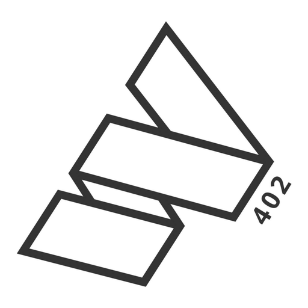
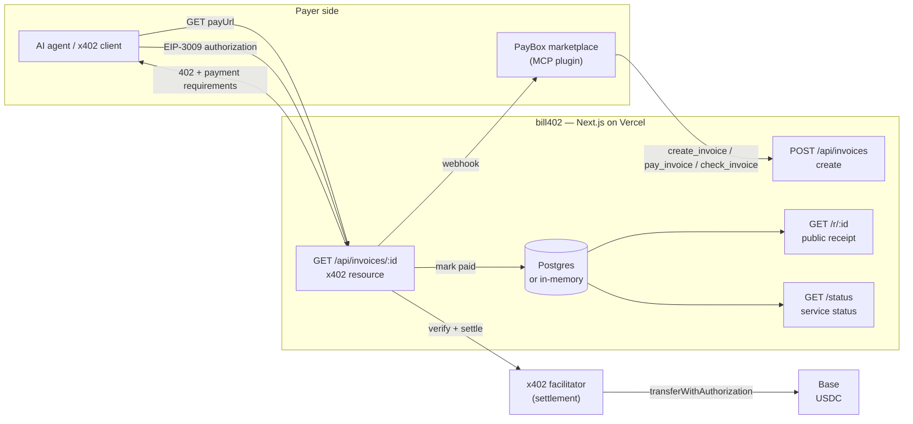
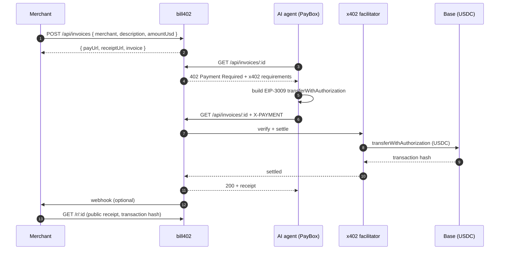

<p align="center">
  <a href="https://bill402.vercel.app">
    
  </a>
</p>

<h1 align="center">bill402</h1>

<p align="center">
  <strong>Invoices any AI agent can pay.</strong><br />
  Invoicing infrastructure for the agent economy — built on x402, settled in USDC on Base.
</p>

<p align="center">
  <a href="https://bill402.vercel.app"></a>
  <a href="https://bill402.vercel.app/status"></a>
  <a href="https://www.x402.org"></a>
  <a href="https://base.org"></a>
  
  <a href="./LICENSE"></a>
</p>

<p align="center">
  
  
  
  
  
</p>

---

## Overview

bill402 turns a USD invoice into an HTTP endpoint that software can pay. A business creates an invoice, receives an x402 payment URL, and shares it with its customer — a person, an agent, or an automated billing system. The payer retrieves the exact payment requirements, settles in USDC on Base, and both sides get a public receipt linked to the on-chain transaction.

There is no signup, no card form, and no credential to distribute to payers.

**Core capabilities**

- **Invoice API** — create an invoice from a form, a `curl` call, or an MCP tool.
- **x402 payment endpoint** — returns a standards-compliant `402` with amount, asset, network, recipient, and Bazaar discovery metadata.
- **Passkey approval** — the payer confirms once in PayBox; private keys are never exposed to the service.
- **Settlement verification** — payments are verified and settled through an x402 facilitator on Base.
- **Public receipts** — every settled invoice has a page with the transaction hash and payer.
- **Webhooks** — an optional `invoice.settled` callback notifies your own systems.
- **Status and metrics** — live counts and settled volume published at [`/status`](https://bill402.vercel.app/status).

## Settled on mainnet

The service has taken a real payment end to end: x402 `exact` with an EIP-3009 authorization, settled in USDC on Base — no testnet, no simulation.

| | |
|---|---|
| Invoice | [`ad5019c8e24e`](https://bill402.vercel.app/r/ad5019c8e24e) — $0.05, Acme Coffee Co |
| Transaction | [`0x7ff6919f…ba851c`](https://basescan.org/tx/0x7ff6919f8b825de8b18db1b4f483021ce237ab148d46b3a4cbb98f5654ba851c) |
| Block | 52,740,412 |
| Transfer | 0.05 USDC to `0x7A35…9Da2` |

The payer that produced it is in `bill402/scripts/settle.mjs`: it reads the live `402`, signs the authorization, and prints the settlement transaction.

Every `402` carries the settlement token's EIP-712 domain (`extra.name`, `extra.version`). Without it an EIP-3009 client cannot build a valid signature, so the field is part of the payment requirements, not an implementation detail.

## How it works

1. **Create an invoice.** Provide a business name, description, USD amount, and optional webhook URL.
2. **Share the payment URL.** The API returns an x402 endpoint and a public receipt URL.
3. **The payer settles.** A client requests the endpoint, receives a `402`, signs an EIP-3009 authorization, and retries. Approval is one passkey confirmation.
4. **Settlement is recorded.** bill402 verifies settlement through the facilitator, stores the transaction, fires the webhook, and publishes the receipt.

## Architecture



## Payment flow



## Product surface

| Route | Method | Description |
| --- | --- | --- |
| `/` | GET | Product overview and documentation |
| `/new` | GET | Invoice creation form |
| `/status` | GET | Service status, settlement metrics, and payment configuration |
| `/r/:id` | GET | Public receipt with the on-chain transaction link |
| `/api/invoices` | POST | Create an invoice → `{ payUrl, receiptUrl, invoice, network }` |
| `/api/invoices/:id` | GET | x402 resource — `402` with exact-scheme USDC requirements, `200` once settled |

### Create an invoice

```bash
curl -X POST https://bill402.vercel.app/api/invoices \
  -H 'Content-Type: application/json' \
  -d '{
    "merchant": "Acme Coffee",
    "description": "100 bags of espresso beans",
    "amountUsd": 49.5,
    "webhookUrl": "https://acme.example/hooks/paid"
  }'
```

```json
{
  "invoice": {
    "id": "8f2a1c4d9b30",
    "merchant": "Acme Coffee",
    "description": "100 bags of espresso beans",
    "amountUsd": 49.5,
    "status": "pending"
  },
  "payUrl": "https://bill402.vercel.app/api/invoices/8f2a1c4d9b30",
  "receiptUrl": "https://bill402.vercel.app/r/8f2a1c4d9b30",
  "network": "eip155:8453"
}
```

A `GET` on the pay URL without a payment header returns `402` with the requirements: scheme `exact`, network `eip155:8453`, the USDC asset address, the amount in base units, the configured recipient, and the token's EIP-712 domain (`extra.name`, `extra.version`) — without that domain an EIP-3009 client cannot build a valid `transferWithAuthorization` signature.

### Webhook payload

```json
{
  "event": "invoice.settled",
  "invoice": {
    "id": "8f2a1c4d9b30",
    "merchant": "Acme Coffee",
    "description": "100 bags of espresso beans",
    "amountUsd": 49.5,
    "status": "paid",
    "paidAt": "2026-10-18T00:00:00.000Z",
    "receiptUrl": "https://bill402.vercel.app/r/8f2a1c4d9b30"
  },
  "settlement": {
    "transaction": "0x…",
    "network": "eip155:8453",
    "payer": "0x…"
  }
}
```

## Settle an invoice

`bill402/scripts/settle.mjs` is a real x402 `exact` payer: it reads the live 402, signs an EIP-3009 authorization, and retries with the payment header.

```bash
node scripts/settle.mjs --new-key          # throwaway payer key in .payer-key (mode 600, gitignored)
node scripts/settle.mjs <invoiceId>        # checks balance first, then pays
node scripts/settle.mjs <invoiceId> --dry-run   # sign only, send nothing
```

It pays USDC on Base and prints the settlement transaction, the receipt URL, and a Basescan link. It refuses to sign when the payer's balance is short of the invoice.

## Configuration

| Variable | Required | Default | Purpose |
| --- | --- | --- | --- |
| `DATABASE_URL` | No | in-memory store | Postgres connection string for invoice persistence |
| `X402_NETWORK` | No | `eip155:84532` | CAIP-2 network id — `eip155:8453` for Base mainnet |
| `PAY_TO` | Yes in production | empty | Recipient address for settled USDC |
| `FACILITATOR_URL` | No | `https://x402.org/facilitator` | x402 facilitator used to verify and settle |
| `NEXT_PUBLIC_BASE_URL` | Yes in production | `http://localhost:3000` | Public origin used in payment and receipt URLs |

`DATABASE_URL` is optional locally: without it, invoices are held in memory and reset on restart. In production the service uses Postgres so invoices and receipts survive deployments.

## Local development

```bash
git clone https://github.com/thesithunyein/bill402.git
cd bill402/bill402
npm install
npm run dev          # http://localhost:3000
```

```bash
npm run build && npm start   # production build
npx tsc --noEmit             # type check
```

## Deployment

The service deploys to Vercel as a standard Next.js application. For Base mainnet, set `X402_NETWORK=eip155:8453`, `PAY_TO`, `FACILITATOR_URL`, `DATABASE_URL`, and `NEXT_PUBLIC_BASE_URL` in the project environment, then deploy from the `bill402/` directory.

## Project structure

```text
bill402/
├── bill402/                        # Next.js 16 service (the deployed app)
│   ├── app/
│   │   ├── page.tsx                # Product overview
│   │   ├── new/                    # Invoice creation
│   │   ├── status/                 # Service status and metrics
│   │   ├── r/[id]/                 # Public receipt
│   │   ├── components/             # Shared header and footer
│   │   ├── api/invoices/           # Create + x402 resource routes
│   │   ├── robots.ts               # robots.txt
│   │   └── sitemap.ts              # sitemap.xml
│   ├── lib/
│   │   ├── store.ts                # Invoice persistence (Postgres | memory)
│   │   └── x402.ts                 # Network, facilitator, payment config
│   └── public/brand/               # Logo, backgrounds, social card
├── bill402-plugin/                 # PayBox marketplace plugin (MCP)
├── SECURITY.md                     # Threat model and disclosure policy
├── CONTRIBUTING.md                 # Development and review expectations
├── CODE_OF_CONDUCT.md              # Contributor Covenant 2.1
└── LICENSE                         # MIT
```

## PayBox plugin

The MCP plugin connects the marketplace to bill402. `pay_invoice` fetches the live requirements and returns an **unsigned** `io.paybox/transactionProposal`; PayBox validates it against the `402`, the user approves with a passkey, and PayBox settles and retries the invoice URL. The plugin never signs, stores, or transmits key material.

```text
Tools:            create_invoice · pay_invoice · check_invoice
Outbound hosts:   bill402.vercel.app
Secrets required: none
Artifact:         bill402-plugin/dist/plugin.mjs (400,067 bytes · sha256 43c265c7…)
```

Verified with the starter toolchain (Node 24.21.0, pnpm 11.11.0): `pnpm test` type-checks, builds twice and requires identical bytes, then runs conformance — `status: "passed"`, three tools discovered, sample call passed. The tools were also exercised against the live service, including the pending-status read and the unsigned x402 proposal.

## Documentation

- [Service documentation](./bill402/README.md) — endpoints, configuration, persistence
- [Plugin documentation](./bill402-plugin/README.md) — tools, conformance, manifest
- [Security policy](./SECURITY.md) — threat model and private disclosure
- [Contributing](./CONTRIBUTING.md) — local setup and review expectations
- [Code of conduct](./CODE_OF_CONDUCT.md) — Contributor Covenant 2.1
- [License](./LICENSE) — MIT

## License

MIT © thesithunyein. See [LICENSE](./LICENSE).
