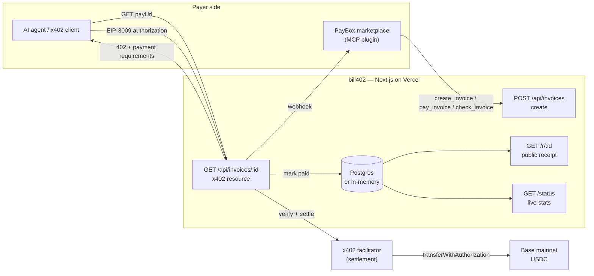

<p align="center">
  <a href="https://bill402.vercel.app">
    
  </a>
</p>

<h1 align="center">bill402</h1>

<p align="center">
  <strong>Invoices any AI agent can pay.</strong><br />
  Create an invoice, get an x402 URL. Agents discover it, you approve with a passkey, it settles in USDC on Base.
</p>

<p align="center">
  <a href="https://bill402.vercel.app"></a>
  <a href="https://bill402.vercel.app/status"></a>
  <a href="https://www.x402.org"></a>
  <a href="https://base.org"></a>
  
  <a href="./LICENSE"></a>
</p>

<p align="center">
  
  
  
  
  
</p>

---

## Why

Agents can already **buy** things over x402, but businesses still can't **bill** them. bill402 is the missing half: a hosted x402 invoice endpoint with a public receipt page and an optional settlement webhook.

- **Merchant** creates an invoice — name, description, USD amount.
- **Agent** discovers the x402 URL on PayBox (or any x402 client) and pays.
- **Buyer** approves once with a passkey. No card forms, no accounts, no human in the loop.
- **Everyone** gets a receipt with the real Base transaction hash.

Built for **MoonPay Hackathons — PayBox Chapter 1** (Merchant tools), Oct 16–17, 2026.

## Architecture



## Payment flow


## Project structure

```text
bill402/
├── bill402/                        # Next.js 16 service (the live app)
│   ├── app/
│   │   ├── page.tsx                # Landing page — hero, how it works, FAQ
│   │   ├── new/page.tsx            # Invoice creation form
│   │   ├── status/page.tsx         # Live settled stats (on-chain proof)
│   │   ├── r/[id]/page.tsx         # Public receipt with Basescan link
│   │   ├── components/
│   │   │   ├── SiteHeader.tsx      # Shared logo + navigation
│   │   │   └── SiteFooter.tsx      # Shared footer
│   │   ├── api/
│   │   │   └── invoices/
│   │   │       ├── route.ts        # POST — create an invoice
│   │   │       └── [id]/route.ts   # GET — x402 pay-per-call resource
│   │   ├── globals.css             # Design system (light, clean, max-width)
│   │   ├── icon.png                # Generated favicon from the logo
│   │   └── layout.tsx              # Metadata, Open Graph, Twitter cards
│   ├── public/brand/
│   │   ├── logo.png                # Main logo (transparent)
│   │   ├── bg-fan.jpg              # Hero / CTA background
│   │   ├── icon-rocket.png         # Create — speed
│   │   ├── icon-code.png           # x402 endpoint
│   │   ├── icon-check.png          # Passkey approval
│   │   └── icon-chart.png          # Receipts / stats
│   ├── lib/
│   │   ├── store.ts                # Invoice persistence (Postgres | memory)
│   │   └── x402.ts                 # Network, facilitator, payment config
│   └── package.json
├── bill402-plugin/                 # PayBox marketplace plugin (MCP)
│   ├── src/
│   │   ├── plugin.ts               # Tool definitions
│   │   └── paybox.ts               # PayBox x402 integration
│   ├── examples/                   # Base transfer, repo info, x402 request
│   ├── scripts/                    # Conformance + report harness
│   └── paybox-plugin.json          # Marketplace manifest
├── LICENSE                         # MIT
├── SECURITY.md                     # Threat model + disclosure policy
├── CODE_OF_CONDUCT.md              # Contributor Covenant 2.1
└── CONTRIBUTING.md                 # Local setup and PR expectations
```

## Quickstart

```bash
git clone https://github.com/thesithunyein/bill402.git
cd bill402/bill402
npm install
npm run dev          # http://localhost:3000
```

No environment variables are required to run locally — invoices fall back to an in-memory store. For production, set `DATABASE_URL` and the x402 facilitator configuration described in [`bill402/README.md`](./bill402/README.md).

```bash
npm run build && npm start   # production build
```

## API

| Route | Method | What it does |
| --- | --- | --- |
| `/` | GET | Landing page |
| `/new` | GET | Invoice creation form |
| `/status` | GET | Settled count, volume, network, facilitator |
| `/r/:id` | GET | Public receipt with on-chain transaction link |
| `/api/invoices` | POST | Create an invoice → `{ payUrl, receiptUrl, invoice }` |
| `/api/invoices/:id` | GET | x402 resource — `402` with exact-scheme USDC requirements |

## PayBox plugin

The plugin uses PayBox's native x402 flow. `pay_invoice` fetches the invoice's live requirements and returns an **unsigned** `io.paybox/transactionProposal`. PayBox validates it against the live `402`, the user approves with a passkey, PayBox pays, and retries the invoice URL. The tool never signs, holds, or sees key material.

```text
Tools: create_invoice · pay_invoice · check_invoice
Outbound hosts: bill402.vercel.app only
Secrets required: none
```

## Documentation

- [Service docs](./bill402/README.md) — endpoints, configuration, persistence
- [Plugin docs](./bill402-plugin/README.md) — tools, conformance, marketplace manifest
- [Security policy](./SECURITY.md) — threat model and private disclosure
- [Code of conduct](./CODE_OF_CONDUCT.md) — Contributor Covenant 2.1
- [Contributing](./CONTRIBUTING.md) — local setup and review expectations
- [License](./LICENSE) — MIT

## License

MIT © thesithunyein. See [LICENSE](./LICENSE).

---

<p align="center">
  <sub>Built for MoonPay Hackathons — PayBox Chapter 1 · x402 v2 · USDC on Base</sub>
</p>
