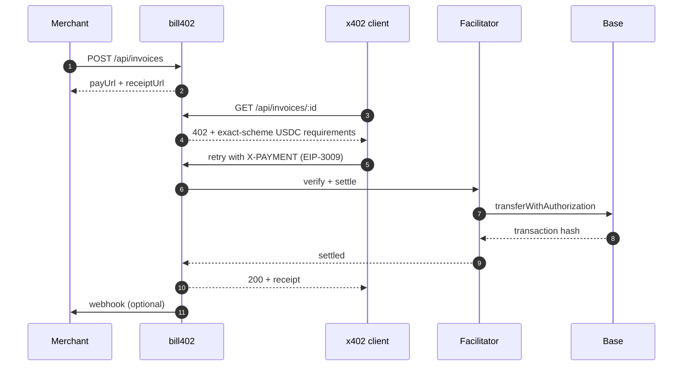

<p align="center">
  <a href="https://bill402.vercel.app">
    
  </a>
</p>

<h1 align="center">bill402 · service</h1>

<p align="center">
  <strong>Invoices any AI agent can pay.</strong><br />
  Next.js 16 · x402 v2 · USDC on Base
</p>

<p align="center">
  <a href="https://bill402.vercel.app"></a>
  
  
  
  
  <a href="../LICENSE"></a>
</p>

---

The bill402 service creates USD invoices and exposes each one as an x402 resource. A payer retrieves the payment requirements, settles in USDC on Base, and receives a public receipt linked to the on-chain transaction. Invoice creation, payment verification, settlement, webhooks, and receipts are handled by this application.

## Payment flow



## Routes

| Route | Description |
| --- | --- |
| `GET /` | Product overview — capabilities, flow, FAQ |
| `GET /new` | Invoice creation form |
| `GET /status` | Settlement metrics and payment configuration |
| `GET /r/:id` | Public receipt with the on-chain transaction link |
| `POST /api/invoices` | Create an invoice → `{ payUrl, receiptUrl, invoice, network }` |
| `GET /api/invoices/:id` | x402 resource — `402` with requirements, `200` once settled |

`POST /api/invoices` accepts `merchant` (max 80 characters), `description` (max 200), `amountUsd` (0.01–10,000), and an optional https `webhookUrl`. Amounts are converted to USDC base units at six decimals.

## Configuration

| Variable | Required | Default | Purpose |
| --- | --- | --- | --- |
| `DATABASE_URL` | No | in-memory store | Postgres connection string; the `invoices` table is created on first use |
| `X402_NETWORK` | No | `eip155:84532` | CAIP-2 network id — `eip155:8453` for Base mainnet |
| `PAY_TO` | Yes in production | empty | Recipient address for settled USDC |
| `FACILITATOR_URL` | No | `https://x402.org/facilitator` | Facilitator used to verify and settle payments |
| `NEXT_PUBLIC_BASE_URL` | Yes in production | `http://localhost:3000` | Public origin used in payment and receipt URLs |

Production runs on Base mainnet with the PayAI facilitator and Postgres persistence. Without `DATABASE_URL`, invoices are stored in memory and reset when the process restarts.

## Local development

```bash
npm install
npm run dev      # http://localhost:3000
npm run build    # production build
npm start
```

No environment variables are required to run locally. For a full payment test, set `PAY_TO` to a Base Sepolia address and create an invoice from `/new`.

## Structure

```text
app/
├── page.tsx                 # Product overview
├── new/                     # Invoice form (client component)
├── status/page.tsx          # Service status
├── r/[id]/page.tsx          # Public receipt
├── not-found.tsx            # Branded 404
├── components/
│   ├── SiteHeader.tsx
│   └── SiteFooter.tsx
├── api/invoices/
│   ├── route.ts             # POST create
│   └── [id]/route.ts        # GET x402 resource
├── globals.css              # Design system
├── icon.png                 # Favicon generated from the logo
├── robots.ts                # robots.txt
├── sitemap.ts               # sitemap.xml
└── layout.tsx               # Metadata, Open Graph, social card
public/brand/                # Logo, background, step icons, social card
lib/
├── store.ts                 # Postgres when DATABASE_URL is set, memory otherwise
└── x402.ts                  # Network, facilitator, payment config
```

## Stack

Next.js 16 · React 19 · TypeScript · x402 v2 (`@x402/core`, `@x402/next`, `@x402/evm`, `@x402/extensions`) · USDC · Base

## Documentation

- [Security policy](../SECURITY.md)
- [Contributing](../CONTRIBUTING.md)
- [Code of conduct](../CODE_OF_CONDUCT.md)
- [License](../LICENSE) — MIT
