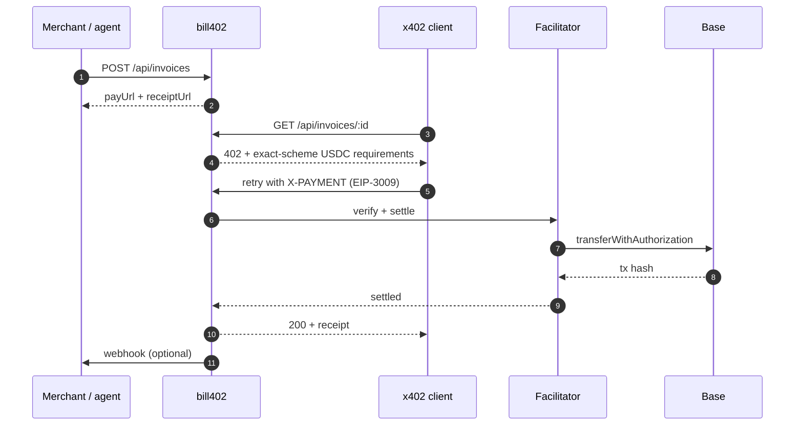

<p align="center">
  <a href="https://bill402.vercel.app">
    
  </a>
</p>

<h1 align="center">bill402 · service</h1>

<p align="center">
  <strong>Invoices any AI agent can pay.</strong><br />
  Next.js 16 · x402 v2 · USDC on Base
</p>

<p align="center">
  <a href="https://bill402.vercel.app"></a>
  
  
  
  
  <a href="../LICENSE"></a>
</p>

---

Invoices any AI agent can pay. Create an invoice, get an x402 URL — agents on PayBox (or any x402 client) discover it, pay in USDC, you get the webhook and an on-chain receipt.

Built for the MoonPay PayBox hackathon, Chapter 1 (Merchant tools).

## Payment flow



## Routes

| Route | What it is |
| --- | --- |
| `GET /` | Landing page — hero, how it works, FAQ, footer |
| `GET /new` | Create-an-invoice form |
| `GET /status` | Settled count, volume, network, facilitator |
| `GET /r/:id` | Public receipt with the on-chain transaction link |
| `POST /api/invoices` | Create an invoice → `{ payUrl, receiptUrl, invoice }` |
| `GET /api/invoices/:id` | x402 pay-per-call resource — returns `402` with requirements |

## Structure

```text
app/
├── page.tsx                 # Landing
├── new/page.tsx             # Invoice form (client)
├── status/page.tsx          # Live stats
├── r/[id]/page.tsx          # Receipt
├── components/
│   ├── SiteHeader.tsx
│   └── SiteFooter.tsx
├── api/invoices/
│   ├── route.ts             # POST create
│   └── [id]/route.ts        # GET x402 resource
├── globals.css              # Design system (light, white default)
├── icon.png                 # Favicon generated from the logo
└── layout.tsx               # Metadata + Open Graph
public/brand/                # Logo, hero background, step icons
lib/
├── store.ts                 # Postgres when DATABASE_URL is set, memory otherwise
└── x402.ts                  # Network, facilitator, payment config
```

## Run it

```bash
npm install
npm run dev      # http://localhost:3000
npm run build    # production build
npm start
```

No environment variables are required locally. Invoices fall back to an in-memory store; set `DATABASE_URL` to persist them.

## Config

Development defaults to Base Sepolia via the x402.org facilitator; production uses Base mainnet via the PayAI facilitator (no API key). Invoice storage uses Postgres when `DATABASE_URL` is set and memory otherwise.

## Stack

Next.js 16 · React 19 · TypeScript · x402 v2 (`@x402/core`, `@x402/next`, `@x402/evm`, `@x402/extensions`) · USDC · Base

## Docs

- [Security policy](../SECURITY.md)
- [Code of conduct](../CODE_OF_CONDUCT.md)
- [Contributing](../CONTRIBUTING.md)
- [License](../LICENSE) — MIT
